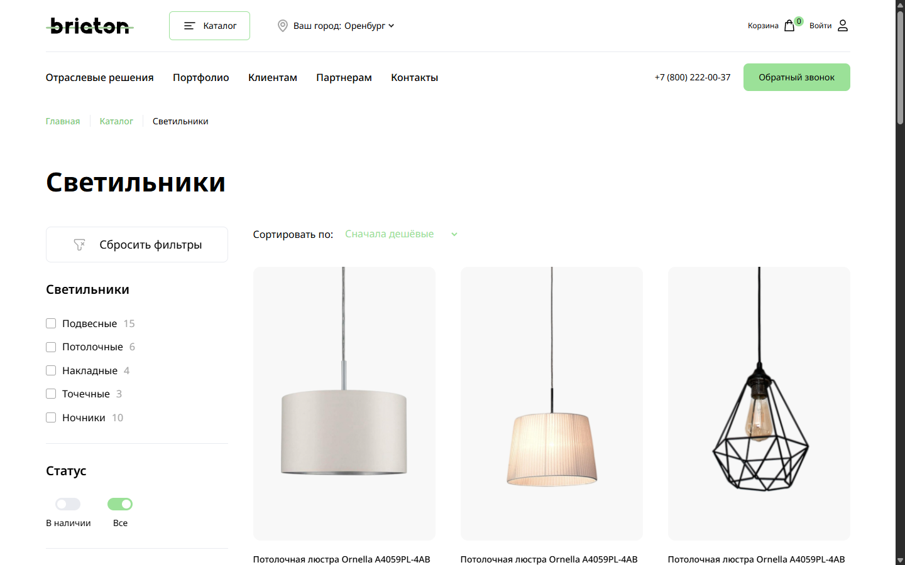
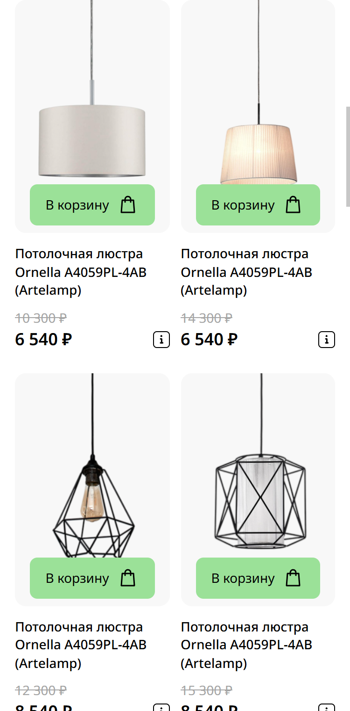

# Briaton — lighting store catalog

**English** | [Русский](README.ru.md)

A catalog page for an online lighting store. Products are loaded from JSON and can be filtered, sorted, paginated and added to a cart. Built with vanilla JavaScript, no frameworks.

<!-- After publishing on GitHub Pages, put the link here: **[Live demo](https://USERNAME.github.io/briaton-catalog/)** -->





> The interface text is in Russian: the project was built from a Russian-language design mockup.

## Features

- **Data-driven catalog.** Product cards are rendered from `data/data.json`; each filter shows how many products match it.
- **Filters and sorting.** Filter by lamp type and availability, sort by price or popularity, reset everything with one button.
- **City selection.** The chosen city is remembered and affects the "In stock" filter, which checks stock in that city only.
- **Pagination.** Six products per page; changing a filter returns the list to the first page.
- **Cart.** Identical products are merged into one row with a quantity counter, the total is recalculated, and the contents are saved in `localStorage`.
- **"Deals of the day" slider** built on Swiper; the number of visible cards adapts to the screen width.
- **Tooltips** with per-city stock, built on Tippy.js.
- **Contact form** with JustValidate validation, `fetch` submission and a result message.
- **Responsive layout** for desktop, tablet (up to 1023px) and mobile (up to 767px).
- **Accessibility.** The menu, cart and city list close on Escape and on outside click, buttons have `aria-expanded` and labels, keyboard focus is visible.

## Tech stack

- HTML5, BEM
- SCSS (`@use` modules, breakpoint mixins)
- JavaScript ES2022, native ES modules
- [Swiper](https://swiperjs.com/), [Tippy.js](https://atomiks.github.io/tippyjs/), [JustValidate](https://just-validate.dev/) — bundled locally in `js/vendor`

## Getting started

Products are loaded with `fetch`, so the page must be served by a local server rather than opened as a file.

```bash
npm install
```

```bash
npm start
```

The site opens at `http://localhost:3000`.

Build styles after editing SCSS:

```bash
npm run build
```

Rebuild on every save:

```bash
npm run watch
```

## Project structure

```text
├── index.html
├── css/                 # compiled styles
├── data/data.json       # products
├── fonts/
├── images/
├── js/
│   ├── main.js          # entry point
│   ├── components/
│   │   ├── state.js     # single state: filters, sorting, page, city
│   │   ├── products.js  # product loading
│   │   ├── catalog.js   # filtering, sorting and list rendering
│   │   ├── card.js      # card markup (shared by catalog and slider)
│   │   ├── pagination.js
│   │   ├── filters.js
│   │   ├── sort.js
│   │   ├── basket.js
│   │   ├── location.js
│   │   ├── burger.js
│   │   ├── accordion.js
│   │   ├── slider.js
│   │   ├── form.js
│   │   ├── tippy.js
│   │   └── utils.js     # price formatting, HTML escaping, localStorage
│   └── vendor/          # third-party libraries
└── scss/
    ├── style.scss
    ├── global/          # variables, mixins, fonts, reset
    ├── blocks/          # one BEM block per file
    └── vendor/
```

## How the code works

Everything the product list depends on lives in a single state object (`state.js`). Filters, sorting, pagination and city selection only update that state and call one function, `renderCatalog()`, which filters, sorts and renders the list again. Modules do not know about each other; `main.js` wires them together.

The cart stores "product id — quantity" pairs and takes names and prices from the catalog, so the two never go out of sync.

## About

A study project. The design mockup and the initial markup come from a course; the JavaScript logic and the responsive layout are my own work. The form posts to the `httpbin.org` test service — the project has no real backend.
